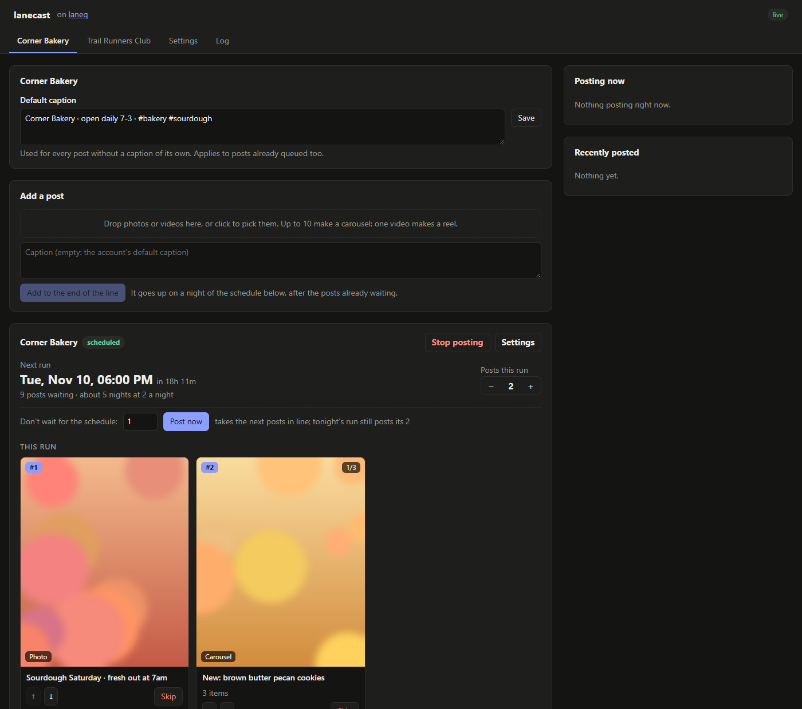

# lanecast



[](#usage-stats)
[](#usage-stats)
[](#usage-stats)

A social media scheduler you run yourself. Each account gets one ordered line of posts, and a nightly
schedule takes the next few off the front. Posts go up in the order you queued them, and never twice,
even if the machine crashes in the middle of publishing.

It runs on [laneq](https://github.com/aaronhhsi/laneq), a small job queue with ordered lanes. lanecast adds
Instagram publishing, a dashboard, and a plugin interface for everything specific to one install.

- **Accounts and posts:** add accounts in the dashboard, then drop in photos or videos with a caption. One
  photo is a photo post, one video is a reel, and 2 to 10 files are a carousel. Each post joins the end of
  its account's line.
- **The schedule:** each account posts N a night at a set time. You can change tonight's count, post the
  next ones now, move a post up or down, skip it or hold it back. **Schedule for all accounts** sets every
  account at once.
- **Safe to retry:** each publish step is checkpointed in laneq. A retry after a crash resumes where it
  stopped, and checks Instagram for the post before publishing, so a post never goes up twice.
- **Instagram's rules handled:** photos are padded (never cropped) to an allowed shape, carousel items to one
  shape, short videos looped to the 3-second minimum, and anti-spam blocks or rate limits wait and retry
  instead of failing.
- **Tokens renew themselves** every 30 days (they last 60).
- **A Log tab** that follows whatever is running.

## Install

One command, and everything goes in one folder. Allow anything Windows or macOS asks about along the way
(installing Python or Git, a firewall prompt for laneq).

**Windows**, in PowerShell:

```powershell
irm https://raw.githubusercontent.com/aaronhhsi/lanecast/main/install.ps1 | iex
```

(or download this repo and double-click `install.cmd`)

**macOS / Linux**, in a terminal:

```sh
curl -fsSL https://raw.githubusercontent.com/aaronhhsi/lanecast/main/install.sh | sh
```

The installer gets Python and Git if they're missing, puts lanecast, its packages, ffmpeg and
[laneq](https://github.com/aaronhhsi/laneq) in one folder (`%LOCALAPPDATA%\lanecast` or `~/lanecast`),
offers to sign you in to GitHub and make the outbox repo, sets lanecast to start when you log in, and opens
the dashboard. Its **Getting started** list walks through the rest: adding accounts, and each account's
Instagram token, step by step.

```
lanecast/
  app/       the code
  env/       its Python packages
  bin/       laneq
  data/      tokens, settings, uploads, logs and the queue
  lanecast   start | stop | status | open | github | update | autostart on|off | uninstall
```

`lanecast update` gets the newest version; `lanecast uninstall` removes the login item and the folder.

### Running it by hand

With Python 3.10+ and a laneq of your own (`go build ./cmd/laneq` in laneq's repo, then run it):

```sh
pip install -e .
python -m lanecast run --mode live     # the worker, with the dashboard on http://127.0.0.1:7080
```

`--mode rehearse` does everything except the final publish (Instagram's unpublished drafts expire on their
own), and `--mode local` only prepares the files and checks the token. Data lives in `~/.lanecast`
(`LANECAST_HOME` to move it): `secrets.env` for tokens, `config.json`, `accounts/`, `media/` and `logs/`.

## Instagram setup

Instagram only lets **professional accounts** (Business or Creator) post through its API, and each install
uses its own Meta app, which stays in development mode, so there's no app review.

1. **The account:** on Instagram, profile → ☰ → **Account type and tools** → **Switch to professional
   account**.
2. **A Meta app**, once: at [developers.facebook.com](https://developers.facebook.com) → **My Apps** →
   **Create app**, with the use case **Manage messaging & content on Instagram**.
3. **Add the account as a tester:** in the app, **App roles → Roles → Add People → Instagram Tester**, then
   accept while logged in as that account at
   [instagram.com/accounts/manage_access](https://www.instagram.com/accounts/manage_access/) → **Tester
   Invites**.
4. **Generate its token:** **Use cases** → **Customize** (next to the Instagram use case) → **API setup with
   Instagram login** → **Generate access tokens** → **Add account**, then **Generate token**.
5. **Paste it** into the account's **Instagram token** in the dashboard. It's saved to `secrets.env` and never
   shown again.

Instagram allows 100 API posts per account in any 24 hours; a carousel counts as one.

## Plugins

Everything specific to one install goes in a plugin instead of a fork, so the plugin keeps getting lanecast's
fixes. A plugin is a Python class with hooks for whatever it changes; every hook defaults to plain lanecast:

```python
import sys
from lanecast.plugin import Plugin
from lanecast.worker import main

class Bakery(Plugin):
    title = "Corner Bakery"
    def default_caption(self, account):
        return "Open daily 7-3 · #bakery"

sys.exit(main(Bakery()))
```

| Hook | What it changes |
|---|---|
| `accounts()` | a fixed list of accounts, instead of adding them in the dashboard |
| `tab()`, `settings()` | fields, buttons and setup checks on an account's tab or Settings |
| `handlers()`, `periodic()` | new job types (e.g. importing posts from somewhere), and anything to keep queued |
| `prepare_media()` | where a post's files come from (e.g. an archive instead of uploads) |
| `default_caption()`, `after_publish()` | captions, and what happens once a post is up |
| `get()`, `post()`, `page_extra()` | dashboard routes, and a script that adds panels, header links and log sources |
| `stats()` | extra totals for the usage report |

A real one: [illitlauver](https://github.com/illitlauver/hub) adds photo archives as the source of posts, weekly
Discord imports with progress panels, and a reel maker, on top of an unchanged lanecast.

## Usage stats

To show how much lanecast is used, each install sends a few totals once a day: a random install id, the
lanecast version, and counts of accounts, posts published, posts waiting and media stored. Never account
names, captions, files or tokens. **Settings → Usage stats** shows exactly what's sent and turns it off.

## How a post goes up

```
prepare   fetch the files and convert them to shapes Instagram accepts
stage     push them to the outbox repo (Instagram downloads from a public URL)
contain   create Instagram's media containers and wait until they're processed   → checkpoint
publish   look for the post first (a retry may follow a publish that reported an error), then publish → checkpoint
```

The checkpoints live in the laneq job, so whichever worker holds the job next picks up from the last one.
A worker that has lost its lease never publishes: another attempt owns the job by then.
